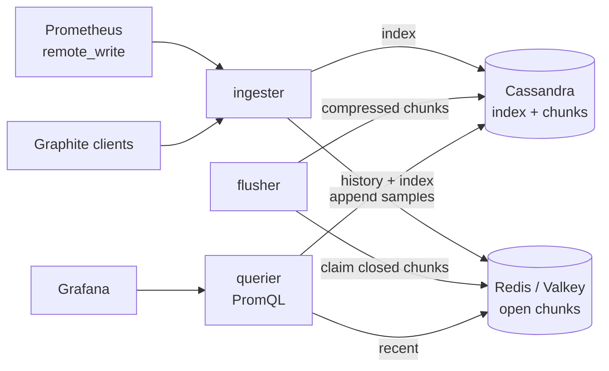

# xtsdb

xtsdb is a horizontally scalable time series database that tiers data
across two kinds of key-value stores: recent samples live in **Redis** (or
Valkey) and older samples are compressed and moved to **Apache Cassandra**.
It speaks the Prometheus Remote Write and Graphite protocols and serves the
Prometheus HTTP API, so Prometheus and Grafana work with it out of the box.

xtsdb implements the ideas of the HeteroTSDB paper (see [Papers](#papers)):
use each store for what it is good at, and scale each tier independently.

> **Status:** v2 is a ground-up rewrite. The storage format is not
> compatible with 0.x, and there is no tagged release yet.

## Features

- **No data loss in the hand-off.** Samples move from Redis to Cassandra
  with an at-least-once protocol based on leases and content-idempotent
  writes, keep working when Redis is full or Cassandra is slow, and stay
  visible to queries throughout. No Redis keyspace notifications are used.
- **Prometheus compatible.** Remote Write 1.0 and 2.0 for ingestion; PromQL
  through `/api/v1/query`, `/api/v1/query_range`, `/api/v1/series`,
  `/api/v1/labels` and `/api/v1/label/<name>/values`, evaluated by the
  Prometheus 3 engine. UTF-8 metric names such as `{"servers.web01.cpu"}`
  are supported.
- **Graphite plaintext** over TCP and UDP, including tags
  (`cpu.user;host=web01 12.5 1700000000`).
- **Series index** in Cassandra, partitioned by day, so label matchers
  (`=`, `!=`, `=~`, `!~`) work on any time range.
- **Gorilla compression** in the persistent tier (Prometheus XOR chunks).
- **Redis 7.0+ standalone, Sentinel or Cluster; Valkey 7.2+** as a drop-in
  replacement. Every Redis script touches a single cluster slot.
- **One binary, four roles** (`ingester`, `flusher`, `querier`, or `all`)
  that scale independently.
- **Operable:** YAML configuration with environment expansion, Prometheus
  metrics, health and readiness endpoints, structured logs, graceful
  shutdown, distroless container image.

## Architecture



1. The **ingester** validates and canonicalizes labels, records the series
   in the index, and appends samples to per-series time windows in Redis.
2. When a window closes (`chunk_range` + `grace_period` after it starts),
   a **flusher** claims it under a lease, compresses it, writes it to
   Cassandra and only then deletes it from Redis.
3. The **querier** resolves label matchers through the index and merges
   samples from both tiers, preferring the most recent write.

See [docs/architecture.md](docs/architecture.md) for the data layout, the
hand-off protocol and its failure handling.

## Quickstart

Requires Docker with Compose v2.

```bash
docker compose up -d --build
```

This starts Redis 8.10, Cassandra 5.0, xtsdb, a Prometheus that
remote-writes into xtsdb, and Grafana with xtsdb as its default data source
at <http://localhost:3000>. Cassandra takes about a minute to become ready.
Nothing in this stack is authenticated, so all ports are published on
127.0.0.1 only.

Send a Graphite sample and query it back:

```bash
echo "servers.web01.load;dc=tokyo 0.75 $(date +%s)" | nc -w1 localhost 2003
curl -s 'http://localhost:9201/api/v1/query' --data-urlencode 'query={"servers.web01.load"}'
curl -s 'http://localhost:9201/api/v1/query' --data-urlencode 'query=rate(prometheus_http_requests_total[5m])'
```

Stop and remove everything with `docker compose down -v`.

## Sending data

**Prometheus** (Remote Write 2.0 shown; omit `protobuf_message` for 1.0):

```yaml
remote_write:
  - url: http://xtsdb:9201/api/v1/write
    protobuf_message: io.prometheus.write.v2.Request
```

**Graphite** plaintext on port 2003 (TCP and UDP):
`<path>[;tag=value...] <value> [<unix timestamp>]`. The path becomes
`__name__` and tags become labels. A missing or negative timestamp means
"now"; `nan` values are skipped.

Samples are accepted until their chunk window closes. Older samples are
rejected (remote write answers `400` with a description), which bounds
backfill through remote write to `chunk_range` + `grace_period`; use
`xtsdb import` for older data (see [Importing history](#importing-history)).
Remote write requests are limited
in size and number of elements, and at most
`ingester.max_inflight_requests` are processed at once (others get 503 and
are retried by Prometheus); see [examples/xtsdb.yaml](examples/xtsdb.yaml).

Graphite lines are written at most one second after they arrive. Graphite
cannot report errors to its clients, so rejected and dropped lines are only
visible in the metrics below and in the logs.

## Importing history

`xtsdb import` writes historical samples directly into Cassandra, as the
flusher would, and indexes them for every day they cover. Use it to migrate
from Prometheus, to re-ingest data lost in an outage longer than the grace
period, or to load data exported from 0.x.

```bash
# Prometheus TSDB blocks: a data directory or a single block. Take a
# snapshot (POST /api/v1/admin/tsdb/snapshot) or stop Prometheus first, so
# that its head is written as a block.
xtsdb import -config.file=xtsdb.yaml -state-file=import.state /prometheus/snapshots/20261105T161114Z-756e151f4435217b

# OpenMetrics text in which every sample has a timestamp, the input format of
# `promtool tsdb create-blocks-from openmetrics` ("-" reads standard input).
xtsdb import -config.file=xtsdb.yaml -format=openmetrics history.om
```

- Importing the same data again writes the same rows, so an interrupted
  import can simply be run again; with `-state-file`, blocks and files that
  were imported completely are skipped.
- Imported samples never override samples xtsdb ingested itself: where both
  exist for a timestamp, the ingested one wins. Imports fill gaps.
- Samples older than `storage.retention` are skipped, and imported samples
  expire `storage.retention` after their timestamp, like ingested ones.
- Native histograms are counted and skipped. A series whose ID collides
  with another series is skipped and logged.
- Only Cassandra is needed; the import checks that `storage.chunk_range` and
  `storage.index_buckets` match the values the data was written with.
  `-concurrency` (16) sets how many series are written at a time.

## Querying

Point any Prometheus client at `http://<querier>:9201`. In Grafana, add a
*Prometheus* data source with that URL. Besides the endpoints listed above,
`/api/v1/status/buildinfo` is implemented, and the rules, alerts, metadata
and exemplar endpoints return empty results so that Grafana works without
warnings.

`/api/v1/series` and the label endpoints default to the last 24 hours when
no `start` is given.

## Running in production

Run `xtsdb <role> -config.file=xtsdb.yaml -config.expand-env` (drop
`-config.expand-env` if your file has no `${VAR}` references). All roles are
stateless and can be scaled horizontally:

| Role       | Scales with                         | Notes |
|------------|-------------------------------------|-------|
| `ingester` | write throughput                    | Put a load balancer in front of `/api/v1/write` and port 2003. |
| `flusher`  | number of closing chunks            | Flushers coordinate through Redis leases; any number can run. |
| `querier`  | query load                          | |

**Redis / Valkey**
- Use `maxmemory-policy noeviction`. Eviction would drop samples that are not
  flushed yet; xtsdb logs a warning at startup otherwise.
- Enable AOF (`appendonly yes`) and replicas: the hot tier holds the most
  recent `chunk_range` + `grace_period` of data.
- Memory needed is roughly 16 bytes per sample held in Redis, plus a small
  sorted set per series with chunks in Redis (its window index).
- Redis 7.0 or later (Valkey 7.2 or later) is required. No
  keyspace-notification or other special configuration is needed.

**Cassandra**
- Create the schema with `xtsdb migrate -config.file=...` (or set
  `cassandra.auto_migrate: true`). Use `NetworkTopologyStrategy` in
  production, and keep `cassandra.consistency` at `LOCAL_QUORUM` (or
  `QUORUM`): reads must see what flushers wrote, otherwise queries can miss
  data while it moves between tiers.
- Samples and index entries expire through TTLs set from
  `storage.retention` (counted from the time of the data, so `retention` must
  be 0 or at least a day); chunk and postings tables use
  `TimeWindowCompactionStrategy`.

**Security.** By default xtsdb's own listeners are neither encrypted nor
authenticated: anyone who can reach the HTTP port can write and query, and
anyone who can reach the Graphite port can write. Either keep them on a
trusted network or behind a reverse proxy that terminates TLS and
authenticates clients, or use the built-in options:

```yaml
server:
  tls:
    cert_file: /etc/xtsdb/tls/server.pem   # reloaded when the files change
    key_file: /etc/xtsdb/tls/server-key.pem
    # client_ca_file: /etc/xtsdb/tls/ca.pem   # mutual TLS
  auth:
    write:   # /api/v1/write
      basic_auth: [{username: prometheus, password: "${XTSDB_WRITE_PASSWORD}"}]
    read:    # query API, /metrics and /debug/pprof
      bearer_tokens: ["${XTSDB_READ_TOKEN}"]
ingester:
  graphite_tls:   # Graphite over TLS on TCP; UDP is then disabled
    cert_file: /etc/xtsdb/tls/server.pem
    key_file: /etc/xtsdb/tls/server-key.pem
    client_ca_file: /etc/xtsdb/tls/ca.pem   # Graphite has no other way to authenticate
```

Each scope accepts any of its basic auth users and bearer tokens; a scope
without credentials is open, and `/-/healthy` and `/-/ready` are always
open. Prometheus sends the credentials with `basic_auth` or `authorization`
in its `remote_write` section, Grafana with the data source's basic auth or
a custom `Authorization` header. Rejected requests get 401 and are counted
in `xtsdb_http_auth_failures_total{scope}`. With `client_ca_file`, clients
must present a certificate signed by that CA
(`client_auth_type: VerifyClientCertIfGiven` makes it optional, for example
for HTTPS health checks). Use `-config.expand-env` to keep secrets out of
the file; `xtsdb config` redacts them.

A reverse proxy is the better choice when you need per-user accounts or
single sign-on, rate limiting, or an existing certificate infrastructure;
the built-in options suit a fixed set of senders and readers.

**Monitoring.** Every role serves `/metrics`, `/-/healthy` and `/-/ready`.
Watch in particular:

| Metric | Meaning |
|--------|---------|
| `xtsdb_flusher_lag_seconds` | How long the oldest closed chunk (pending or claimed) has been waiting. Should stay near zero. |
| `xtsdb_hot_pending_chunks`, `xtsdb_hot_inflight_chunks` | Chunks held in Redis. |
| `xtsdb_flusher_chunks_total{outcome="error"}` | Failed flushes; they are retried after the lease. |
| `xtsdb_hot_quarantined_chunks`, `xtsdb_flusher_chunks_total{outcome="quarantined"}` | Undecodable chunks moved out of the way. Should stay at zero; inspect them with `xtsdb quarantine list`. |
| `xtsdb_ingester_samples_total{outcome=...}` | Accepted samples and rejections: `too_old`, `too_new`, `invalid`, `chunk_full`, `collision`, `unsupported` (histograms), `throttled`, `error`. |
| `xtsdb_ingester_series_collisions_total` | Series refused because another label set already uses their 64-bit ID. Both label sets are logged. |
| `xtsdb_graphite_lines_total{outcome="dropped"}`, `xtsdb_graphite_connections_total{outcome="rejected"}` | Graphite overload. |

**Quarantined chunks.** A chunk that Redis holds but that cannot be decoded
is moved to a quarantine key instead of blocking flushing, and kept for
`flusher.quarantine_ttl` (30 days by default). List them with
`xtsdb quarantine list -config.file=...` and delete them with
`xtsdb quarantine delete -config.file=... <key>...` (or `-all`). See
[docs/architecture.md](docs/architecture.md#quarantined-chunks).

**Configuration.** [examples/xtsdb.yaml](examples/xtsdb.yaml) documents every
option with its default. `xtsdb config -config.file=...` prints the
effective configuration. With `-config.expand-env`, `${VAR}` and
`${VAR:-default}` are replaced by environment variables. `storage.key_prefix`,
`storage.shards`, `storage.chunk_range` and `storage.index_buckets` must not
change once data exists; xtsdb refuses to start if `shards` or `chunk_range`
differ from the values recorded in Redis, or `index_buckets` from the value
recorded in Cassandra.

## Building and testing

Requires Go 1.27.

```bash
make build              # bin/xtsdb
make test               # unit tests
make test-integration   # starts Redis and Cassandra with Docker Compose, then runs all tests
make lint               # go vet + golangci-lint
make docker             # container image
```

Integration tests run against the servers named by
`XTSDB_TEST_REDIS_ADDRS` (comma separated; set `XTSDB_TEST_REDIS_CLUSTER=1`
for Redis Cluster) and `XTSDB_TEST_CASSANDRA_HOSTS`, and are skipped when
those are unset. `XTSDB_TEST_STRESS=1` also runs a stress test that indexes
a million series sharing one label pair.

Tested with Go 1.27.3, Redis 8.10.3 (standalone and Cluster), Valkey 9.1.3,
Cassandra 5.0.9, Prometheus 3.15.1 and Grafana 13.3.0.

## Limitations

- Native histograms and exemplars are not supported yet. Requests that
  carry histograms store their float samples and answer 400, so Prometheus
  reports the dropped histograms instead of silently losing them.
- No multi-tenancy, remote read, downsampling or recording rules.
  Authentication distinguishes writers from readers, not tenants.
- Samples older than their closed chunk window are rejected by remote write
  and Graphite; history is loaded with `xtsdb import`.
- A series can hold at most about two million samples per chunk window in
  Redis (32 MiB); more are rejected as `chunk_full`.
- Queries reach back at most `storage.retention`, or
  `querier.max_query_lookback` (default one year) when retention is 0.
- Series are identified by a 64-bit hash of their labels. Collisions are
  detected: the series that was indexed first keeps the ID and samples of
  the other one are rejected (`outcome="collision"`).
- Index partitions grow with the number of series sharing a label pair (or
  values of a label) on one day, divided by `storage.index_buckets` (16 by
  default): about 62,500 rows per partition for a million series.
- Only Redis/Valkey and Cassandra are implemented, but the tiers sit behind
  interfaces (`internal/storage`) so that other stores such as DynamoDB,
  Bigtable or object storage can be added.

## Upgrading from 0.x

0.x stored data in a different layout (`datapoint` table) that is not read
by v2. There is no migration tool; run v2 against a new keyspace and Redis
key prefix.

## Papers

1. <u>坪内佑樹</u>, 脇坂朝人, 濱田健, 松木雅幸, 小林隆浩, 阿部博, 松本亮介, **[HeteroTSDB: 異種分散KVS間の自動階層化による高性能な時系列データベース](http://id.nii.ac.jp/1001/00210244/)**, 情報処理学会論文誌, Vol.62, No.3, pp.818-828, 2021年3月. [[paper](https://yuuk.io/papers/2021/heterotsdb_ipsj_journal.pdf)] [[code](https://github.com/yuuki/xtsdb)]

Experiments for the paper: [xtsdb-experiments](https://github.com/yuuki/xtsdb-experiments)
(they used the 0.x implementation).

## License

```
Copyright 2020 Yuuki Tsubouchi

Licensed under the Apache License, Version 2.0 (the "License");
you may not use this file except in compliance with the License.
You may obtain a copy of the License at

    http://www.apache.org/licenses/LICENSE-2.0

Unless required by applicable law or agreed to in writing, software
distributed under the License is distributed on an "AS IS" BASIS,
WITHOUT WARRANTIES OR CONDITIONS OF ANY KIND, either express or implied.
See the License for the specific language governing permissions and
limitations under the License.
```

## Author

[yuuki](https://github.com/yuuki)
