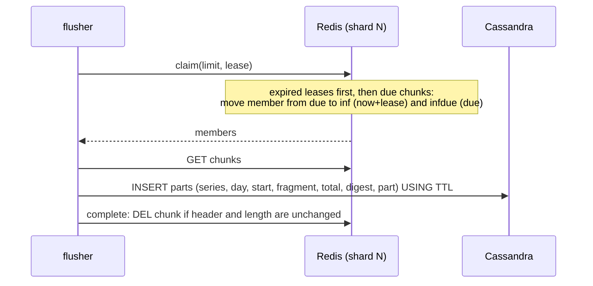

# xtsdb architecture

This document describes how xtsdb stores data and why the design is safe
against the failures that a two-tier time series database has to survive.

## Goals

1. Never lose an acknowledged sample when it moves between tiers.
2. Scale each tier and each role independently.
3. Be usable from the existing ecosystem (Prometheus, Graphite, Grafana)
   without custom clients.
4. Keep the tiers behind small interfaces (`internal/storage`) so that other
   key-value stores can be added.

## Components

| Package | Responsibility |
|---------|----------------|
| `internal/model` | Label canonicalization, series IDs, sharding, chunk windows, day buckets. Part of the storage format. |
| `internal/chunk` | Raw sample records (hot tier), Gorilla/XOR blobs (cold tier), merging and de-duplication. |
| `internal/hot` | Hot tier on Redis/Valkey: Lua scripts for append, claim, complete. |
| `internal/cassandra` | Cold tier and series index on Cassandra; schema migration. |
| `internal/ingest` | Writer (validation, index, append), Remote Write 1.0/2.0 handler, Graphite server. |
| `internal/flush` | Flusher: moves closed chunks from the hot to the cold tier. |
| `internal/query` | Matcher resolution, tier merge, Prometheus HTTP API on the Prometheus PromQL engine. |
| `internal/app`, `cmd/xtsdb` | Wiring of roles, configuration, lifecycle. |

## Data model

**Series identity.** Labels are validated (UTF-8, length and count limits,
`__name__` required), empty values are dropped and the set is sorted. The
series ID is the xxhash64 of `name 0xff value 0xff ...` over the sorted
labels. Because the hash input is fixed, IDs do not depend on label order
or on the in-memory label representation; a golden test pins the function.

Two different label sets can hash to the same ID: over the series held
during the retention period, the probability is about n²/2⁶⁵ (2.7e-4 for
10⁸ series, 2.7% for 10⁹). Such collisions are detected when the series
is indexed (see [Series index](#series-index-cassandra)): the series that
recorded the ID first keeps it, and samples of the other one are rejected.

**Shards.** A series belongs to hot-tier shard
`(id >> 32) mod storage.shards`. All keys of a shard share the Redis hash
tag `{N}`, so they live in one Redis Cluster slot and Lua scripts over a
shard are atomic. With the default 256 shards the load spreads across up to
256 slots regardless of how series are labelled (0.x used the `hostname`
label as the hash tag, which put all untagged Graphite data in one slot).

**Chunk windows.** Samples of a series are grouped into windows of
`chunk_range`. Window boundaries are offset per series
(`id mod chunk_range`), so windows of different series close at different
times and flushing is spread out instead of happening in bursts.
A window is *due* at `start + chunk_range + grace_period`.

## Hot tier (Redis)

```
<prefix>:{N}:c:<series>:<window>           chunk: 16-byte header + 16-byte records
<prefix>:{N}:due                           ZSET  member -> due time (ms), not yet claimed
<prefix>:{N}:inf                           ZSET  member -> lease expiry (ms), claimed
<prefix>:{N}:infdue                        ZSET  member -> due time (ms), claimed
<prefix>:{N}:clock                         last fragment issued in the shard
<prefix>:{N}:q:<series>:<window>:<digest>  quarantined chunk (undecodable)
<prefix>:{N}:qidx                          ZSET  quarantine key -> expiry time (ms)
<prefix>:meta                              HASH  layout parameters (shards, chunk range)
```

The chunk header is the chunk's *fragment*: 16 ASCII digits that identify
this incarnation of the window and order it after every earlier
incarnation. It comes from a hybrid clock per shard: the Redis server time
in microseconds, or one more than the last fragment issued in the shard
(`<prefix>:{N}:clock`) when the server clock is behind it. Fragments
therefore keep increasing when the Redis clock steps backwards (an NTP step,
or a failover to a node with a slower clock); after a restore from an
older snapshot, which rewinds the shard clock, the server time has normally
moved past the fragments issued before. Records are a big-endian
timestamp (ms) and IEEE-754 value, appended in arrival order, so an append
never reads the chunk. A chunk is limited to 32 MiB (about two million
samples); samples beyond that are rejected (`outcome="chunk_full"`) rather
than creating a chunk that cannot be flushed.

xtsdb refuses to start if `storage.shards` or `storage.chunk_range` differ
from the values recorded in `<prefix>:meta`, because either change would make
existing chunks unreachable.

### Ingestion

Before anything is stored, the ingester:

- bounds remote write requests: compressed and decompressed size, strict
  Snappy (no S2 extensions), and the number of series, samples, labels and
  other elements, counted on the wire before protobuf decoding (decoding
  inflates empty elements up to 64 times); concurrent requests beyond
  `ingester.max_inflight_requests` get 503;
- drops samples older than `chunk_range + grace_period` (+1 minute of clock
  skew) or further than `max_sample_future` in the future, so that
  out-of-range timestamps never reach the index;
- writes the index, so that a stored sample always belongs to a
  discoverable series, and rejects the samples of a series whose ID is
  already used by a different label set (`outcome="collision"`).

Graphite TCP lines wait at most one second in a batch, whether or not more
data arrives. Connections are capped (`graphite_max_connections`), idle
connections are closed after five minutes, and accept errors such as
`EMFILE` are retried with back-off. UDP datagrams are copied off the socket
by one goroutine and parsed by a worker pool; when the workers fall behind,
datagrams are dropped and counted (`outcome="dropped"`).

### Append (ingester)

One Lua script call per shard and batch (`internal/hot/scripts.go`):

1. Read the server time with `TIME` and compute the fragment for chunks
   created by this call.
2. For every chunk in the batch: if the window is due, or the chunk is
   currently claimed by a flusher, reject its samples (`too_old`); if the
   chunk would exceed its size limit, reject them (`chunk_full`).
3. Otherwise create the chunk with its header if needed, register it in
   `due` with its due time, and `APPEND` the records.

Scripts are run with `EVALSHA` in pipelines and transparently fall back to
`EVAL` when a node lost its script cache (restart, failover, `SCRIPT
FLUSH`, new cluster node). The append script has no flags, so Redis refuses
it as a whole when it is out of memory (the client gets 503 and retries).

### Hand-off protocol (flusher)



Invariants:

- **A due window is immutable.** Append and claim compare against the same
  Redis node clock inside atomic scripts, so once `claim` can see a chunk,
  no append to it can succeed. 0.x had a window between `GET` and `UNLINK`
  in which appended samples were deleted.
- **Delete after persist.** A chunk is deleted only after all its parts were
  written to Cassandra.
- **Leases, not ownership.** A claimed chunk whose flusher dies or is too
  slow is handed out again when its lease expires.
- **Idempotent by content.** The Cassandra key includes the chunk's sample
  count and a hash of its samples. Writing the same chunk twice stores it
  once; writing a different version of the same window (for example after
  Redis was restored from an older snapshot) stores a second version
  instead of overwriting a more complete one. Reads merge all versions.
- **Fenced completion.** `complete` deletes a chunk only if its header and
  its length are still those that were persisted. A flusher whose lease
  expired cannot delete a newer incarnation, and samples appended after the
  chunk was loaded (possible only after a failover to a lagging replica)
  are not deleted: the chunk is re-processed after its lease.
- **No leaks.** In-flight entries whose chunk no longer exists are released.
- **Fenced quarantine.** A chunk that cannot be decoded is moved to a
  quarantine key so that it does not block flushing, but only if its first
  16 bytes and its length are still those that were read, exactly like
  `complete`. A healthy newer incarnation of the window is never moved
  away. See [Quarantined chunks](#quarantined-chunks).
- **Flushing works when Redis is full.** claim, complete and quarantine are
  flagged `allow-oom`; with `noeviction`, flushing is the only way memory is
  freed, so it must not be refused.
- **Progress under slow storage.** A batch stops starting new writes once
  its lease has expired, completes what it persisted with its own timeout,
  and a flusher moves on when a batch made no progress.

No Redis keyspace notifications are used. 0.x relied on them; they are
node-local, delivered at most once and require special server
configuration, and a mismatch between notification payloads and key names
left data in Redis forever.

### Failure handling

| Failure | Outcome |
|---------|---------|
| Flusher crashes after claim | Lease expires, another flusher claims and persists the chunk. |
| Cassandra unavailable or slow | Persist fails or is skipped, the chunk stays in Redis and is retried after the lease. `xtsdb_flusher_lag_seconds` grows (it covers claimed chunks too), and queries still read the chunk from Redis. |
| Two flushers persist the same chunk | Same primary key, written once. The second `complete` is a no-op. |
| Redis out of memory (`noeviction`) | Appends are refused (503, clients retry); claim and complete keep working, so flushing frees memory. |
| Redis restart / `SCRIPT FLUSH` | Scripts are reloaded automatically. Unflushed data loss is bounded by the Redis persistence settings. |
| Redis restored from an older snapshot, or failover to a lagging replica | Chunks flushed since the snapshot may be flushed again with less data; they are stored as separate versions and never overwrite the complete one. |
| Undecodable chunk | Moved to a quarantine key (fenced, see below), logged and counted; it does not block flushing. |
| Very large chunk | Persisted in parts of 100,000 samples, below Cassandra's mutation limit. |
| Sample for a closed window | Rejected and counted (`outcome="too_old"`); remote write returns 400. |
| Redis clock moves backwards | A claimed chunk still rejects appends (the in-flight check). A chunk re-created after completion gets a larger fragment from the shard clock and is stored as a separate version that takes precedence; reads merge versions. |
| Index write fails | The batch fails with 503 before any sample is stored; the client retries. |

### Quarantined chunks

A chunk that cannot be decoded (its length is not a whole number of
records, or its header is not a timestamp) can only be the result of a bug
or of tampering with Redis, but it must neither block flushing nor be lost
silently:

- It is renamed to `<prefix>:{N}:q:<series>:<window>:<digest>`, where
  `digest` is the xxhash64 of its content. Different chunks of the same
  window therefore never overwrite each other in quarantine.
- The rename is fenced on the first 16 bytes and the length that were read.
  If the chunk changed since (a newer incarnation after a failover or a
  clock step), it stays in flight and is read again after its lease.
- The quarantine key is recorded in `<prefix>:{N}:qidx` and expires after
  `flusher.quarantine_ttl` (30 days by default; 0 keeps it until it is
  deleted).
- `xtsdb_flusher_chunks_total{outcome="quarantined"}` counts quarantines and
  `xtsdb_hot_quarantined_chunks` reports how many are held. Queries do not
  read quarantined chunks.

`xtsdb quarantine list` shows every quarantined chunk with its series ID,
window, size, header and expiry; `redis-cli GET <key>` returns the raw
content (16-byte header followed by 16-byte big-endian records of
timestamp and IEEE-754 value). `xtsdb quarantine delete <key>...` or
`xtsdb quarantine delete -all` deletes them.

## Cold tier (Cassandra)

```sql
CREATE TABLE chunks (
  series_id bigint, day int, start_ms bigint,
  fragment bigint, total int, digest bigint, part int,
  max_t bigint, samples int, encoding tinyint, data blob,
  PRIMARY KEY ((series_id, day), start_ms, fragment, total, digest, part)
) WITH compaction = {'class': 'TimeWindowCompactionStrategy', ...};
```

`day` is the UTC day of the window start, which bounds partition size.
`(fragment, total, digest)` identify a version of a window, `part` splits
large versions into rows of at most 100,000 samples. The blob is a sequence
of length-prefixed Prometheus XOR chunks of sorted, de-duplicated samples
(Gorilla encoding; typically 1–2 bytes per sample compared to 16 in Redis).
Rows carry `USING TTL` from `storage.retention`, and TWCS drops whole
SSTables when they expire.

`total` is the number of samples appended to the incarnation in Redis,
including samples that were overwritten by a later sample with the same
timestamp: an incarnation only grows, so a larger `total` is a later state
of it.

Reads for `[mint, maxt]` query the day partitions of
`[mint - chunk_range, maxt]` with a clustering range on `start_ms`,
concatenate the parts of each version and merge versions in clustering
order. Where versions disagree on the value at a timestamp, the version
that sorts last wins:

1. the larger `fragment`: a later incarnation of the window;
2. then the larger `total`: a later state of the same incarnation, for
   example the complete chunk rather than what an older snapshot held;
3. then the larger `digest` as a signed 64-bit value. Versions with equal
   `fragment` and `total` but different content can only come from diverging
   histories of one incarnation (a restore or a failover to a lagging
   replica, followed by different writes to the same window). Which one is
   newer cannot be known; the digest makes the choice deterministic and the
   same for every reader, but arbitrary.

All of this matters only when a client writes different values for the same
timestamp of a series and, around the same time, Redis fails over, is
restored or its clock steps.

## Series index (Cassandra)

```sql
series       (series_id) -> labels map
postings     ((day, name, value), series_id)
label_values ((day, name), value)
label_names  (day, name)
```

The ingester writes the entries of a series once per UTC day it has samples
on, guarded by an LRU cache and de-duplicated within a batch. Index rows
live two days longer than samples. Day partitions keep postings bounded and
make lookups time aware: a series that disappeared last month is not a
candidate for today's queries.

**Collision detection.** The `series` row is written with one lightweight
transaction per series and day:

```sql
UPDATE series USING TTL ? SET labels = ? WHERE series_id = ?
  IF labels IN (?, null)
```

It creates the row, or refreshes its TTL when it already holds the same
labels. When the ID belongs to different labels, nothing is written: the
ingester rejects the samples of the new series (`outcome="collision"`,
remote write answers 400), counts the series in
`xtsdb_ingester_series_collisions_total`, logs both label sets and does not
write its postings or label values. Later samples of that series are
rejected from a small cache without asking Cassandra again. The ingester's
cache of indexed series is keyed by the ID and a second, independent hash
of the labels, so a colliding series is never taken for the cached one.
Transactions use `LOCAL_SERIAL` when `cassandra.consistency` is a `LOCAL_`
level and `SERIAL` otherwise.

The transaction costs a few more round trips than a plain write, once per
series and day. 128-bit series IDs would make collisions practically
impossible, but would change the storage format.

## Read path

1. **Bound the range.** Queries are clamped to `storage.retention` (or
   `querier.max_query_lookback` when retention is 0, default one year), which
   bounds the number of day partitions read. At most
   `querier.max_concurrent_queries` queries run at once, each bounded by
   `querier.timeout`, including the series and label endpoints.
2. **Resolve matchers** for each day of the range. Matchers that do not
   match the empty string select postings: `=` reads one partition, `=~` with
   a literal alternation reads one partition per alternative, other matchers
   filter `label_values` first. Cheap matchers run first; once 1,024 or fewer
   candidates remain, expensive matchers are not resolved through the index
   but applied to the labels. Postings are intersected across matchers and
   unioned across days. Selectors without such a matcher are rejected, as in
   Prometheus.
3. **Load labels** of the candidates (LRU cached) and apply all matchers,
   including negative ones, on the full label sets.
4. **Evaluate PromQL** with the Prometheus 3 engine through the
   `storage.Queryable` interface. Samples are loaded lazily, 256 series at a
   time, when the engine iterates a series, so `querier.max_samples` stops a
   query before all of its raw samples are in memory.
5. **Read samples** of a batch from Redis first and Cassandra second, and
   merge them; hot samples win on equal timestamps.

The order of step 5 is what makes the hand-off invisible to queries. A
flusher writes a chunk to Cassandra before deleting it from Redis, so a
chunk missing from the Redis read was already in Cassandra when the
Cassandra read started. Reading both tiers concurrently (as an earlier
version of v2 did) loses chunks that are persisted after the Cassandra read
and deleted before the Redis read. With Cassandra replication, the read and
write consistency levels must overlap (`LOCAL_QUORUM`, the default) for the
same argument to hold.

Redis is read for at least `querier.hot_lookback` and, using the oldest due
time in the `due` and `infdue` sets (refreshed every 10 seconds), back to the
oldest chunk Redis still holds, so data stays visible while flushing lags.

## Changes from 0.x

| 0.x | v2 |
|-----|-----|
| Keyspace notifications + Redis Streams to detect expiry; payloads without the `ts:` prefix meant series that stopped receiving writes were never flushed | Due/in-flight sorted sets polled by flushers; no notifications |
| `GET` then `UNLINK` race lost concurrent appends | Due windows are immutable; completion fenced by header and length |
| Failed batches stuck in the stream's pending list forever | Leases with automatic re-claim |
| Graphite millisecond timestamps written as seconds (year 58815) | One timestamp unit (ms) end to end, tested |
| `EVALSHA` without fallback: writes failed after Redis restart | `EVALSHA` with automatic `EVAL` fallback |
| Series ID depended on tag order; `hostname` tag as hash tag | Canonical sorted labels; hash-based shards |
| No index, no query support (querier crashed on start) | Day-partitioned index, PromQL, Prometheus HTTP API |
| Raw 16-byte samples in Cassandra, unbounded partitions, consistency `ANY` | XOR compression, day partitions, TTL, TWCS, configurable consistency |
| Go 1.14, go-redis v7, gocql 2020, VictoriaMetrics 1.35 | Go 1.27, go-redis v9, Apache Cassandra GoCQL driver v2, Prometheus 3.15 |
