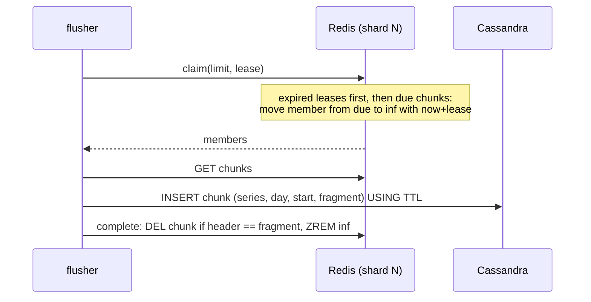

# xtsdb architecture

This document describes how xtsdb stores data and why the design is safe
against the failures that a two-tier time series database has to survive.

## Goals

1. Never lose an acknowledged sample when it moves between tiers.
2. Scale each tier and each role independently.
3. Be usable from the existing ecosystem (Prometheus, Graphite, Grafana)
   without custom clients.
4. Keep the tiers behind small interfaces (`internal/storage`) so that other
   key-value stores can be added.

## Components

| Package | Responsibility |
|---------|----------------|
| `internal/model` | Label canonicalization, series IDs, sharding, chunk windows, day buckets. Part of the storage format. |
| `internal/chunk` | Raw sample records (hot tier), Gorilla/XOR blobs (cold tier), merging and de-duplication. |
| `internal/hot` | Hot tier on Redis/Valkey: Lua scripts for append, claim, complete. |
| `internal/cassandra` | Cold tier and series index on Cassandra; schema migration. |
| `internal/ingest` | Writer (validation, index, append), Remote Write 1.0/2.0 handler, Graphite server. |
| `internal/flush` | Flusher: moves closed chunks from the hot to the cold tier. |
| `internal/query` | Matcher resolution, tier merge, Prometheus HTTP API on the Prometheus PromQL engine. |
| `internal/app`, `cmd/xtsdb` | Wiring of roles, configuration, lifecycle. |

## Data model

**Series identity.** Labels are validated (UTF-8, length and count limits,
`__name__` required), empty values are dropped and the set is sorted. The
series ID is the xxhash64 of `name 0xff value 0xff ...` over the sorted
labels. Because the hash input is fixed, IDs do not depend on label order
or on the in-memory label representation; a golden test pins the function.

**Shards.** A series belongs to hot-tier shard
`(id >> 32) mod storage.shards`. All keys of a shard share the Redis hash
tag `{N}`, so they live in one Redis Cluster slot and Lua scripts over a
shard are atomic. With the default 256 shards the load spreads across up to
256 slots regardless of how series are labelled (0.x used the `hostname`
label as the hash tag, which put all untagged Graphite data in one slot).

**Chunk windows.** Samples of a series are grouped into windows of
`chunk_range`. Window boundaries are offset per series
(`id mod chunk_range`), so windows of different series close at different
times and flushing is spread out instead of happening in bursts.
A window is *due* at `start + chunk_range + grace_period`.

## Hot tier (Redis)

```
<prefix>:{N}:c:<series>:<window>   chunk: 16-byte header + 16-byte records
<prefix>:{N}:due                   ZSET  member -> due time (ms)
<prefix>:{N}:inf                   ZSET  member -> lease expiry (ms)
<prefix>:{N}:q:<series>:<window>   quarantined chunk (undecodable)
<prefix>:meta                      HASH  layout parameters (shards)
```

The chunk header is the creation time of the chunk in microseconds as
16 ASCII digits, taken from the Redis server clock. It identifies this
incarnation of the window (its *fragment*). Records are a big-endian
timestamp (ms) and IEEE-754 value, appended in arrival order, so an append
never reads the chunk.

### Append (ingester)

One Lua script call per shard and batch (`internal/hot/scripts.go`):

1. Read the server time with `TIME`.
2. For every chunk in the batch: if the window is due, or the chunk is
   currently claimed by a flusher, reject its samples.
3. Otherwise create the chunk with its header if needed, register it in
   `due` with its due time, and `APPEND` the records.

The ingester writes the index before appending, so a stored sample always
belongs to a discoverable series. Scripts are run with `EVALSHA` in
pipelines and transparently fall back to `EVAL` when a node lost its script
cache (restart, failover, `SCRIPT FLUSH`, new cluster node).

### Hand-off protocol (flusher)



Invariants:

- **A due window is immutable.** Append and claim compare against the same
  Redis node clock inside atomic scripts, so once `claim` can see a chunk,
  no append to it can succeed. 0.x had a window between `GET` and `UNLINK`
  in which appended samples were deleted.
- **Delete after persist.** A chunk is deleted only after the Cassandra
  write succeeded.
- **Leases, not ownership.** A claimed chunk whose flusher dies is handed
  out again when its lease expires. Writes are idempotent because the
  Cassandra primary key is `(series, day, start, fragment)`.
- **Fenced completion.** `complete` deletes a chunk only if its header still
  matches the fragment that was persisted, so a flusher whose lease expired
  cannot delete a newer incarnation of the same window.

No Redis keyspace notifications are used. 0.x relied on them; they are
node-local, delivered at most once and require special server
configuration, and a mismatch between notification payloads and key names
left data in Redis forever.

### Failure handling

| Failure | Outcome |
|---------|---------|
| Flusher crashes after claim | Lease expires, another flusher claims and persists the chunk. |
| Cassandra unavailable | Persist fails, chunk stays in Redis, retried after the lease. `xtsdb_flusher_lag_seconds` grows. |
| Two flushers persist the same chunk | Same primary key, written once. The second `complete` is a no-op. |
| Redis restart / failover / `SCRIPT FLUSH` | Scripts are reloaded automatically. Data loss is bounded by the Redis persistence and replication settings. |
| Undecodable chunk | Moved to a quarantine key and logged; it does not block flushing. |
| Sample for a closed window | Rejected and counted (`outcome="too_old"`); remote write returns 400. |
| Redis clock moves backwards | A claimed chunk still rejects appends (the in-flight check). A chunk re-created after completion is a new fragment and is stored as a separate Cassandra row; reads merge fragments. |
| Index write fails | The batch fails with 503 before any sample is stored; the client retries. |

## Cold tier (Cassandra)

```sql
CREATE TABLE chunks (
  series_id bigint, day int, start_ms bigint, fragment bigint,
  max_t bigint, samples int, encoding tinyint, data blob,
  PRIMARY KEY ((series_id, day), start_ms, fragment)
) WITH compaction = {'class': 'TimeWindowCompactionStrategy', ...};
```

`day` is the UTC day of the window start, which bounds partition size. The
blob is a sequence of length-prefixed Prometheus XOR chunks of sorted,
de-duplicated samples (Gorilla encoding; typically 1–2 bytes per sample
compared to 16 in Redis). Rows carry `USING TTL` from `storage.retention`,
and TWCS drops whole SSTables when they expire.

Reads for `[mint, maxt]` query the day partitions of
`[mint - chunk_range, maxt]` with a clustering range on `start_ms`, decode
the fragments and merge them, later fragments winning on equal timestamps.

## Series index (Cassandra)

```sql
series       (series_id) -> labels map
postings     ((day, name, value), series_id)
label_values ((day, name), value)
label_names  (day, name)
```

The ingester writes the entries of a series once per UTC day it has samples
on, guarded by an LRU cache and de-duplicated within a batch. Index rows
live two days longer than samples. Day partitions keep postings bounded and
make lookups time aware: a series that disappeared last month is not a
candidate for today's queries.

## Read path

1. **Resolve matchers** for each day of the query range. Matchers that do
   not match the empty string select postings: `=` reads one partition,
   `=~` with a literal alternation reads one partition per alternative,
   other matchers filter `label_values` first. Postings are intersected
   across matchers and unioned across days. Selectors without such a
   matcher are rejected, as in Prometheus.
2. **Load labels** of the candidates (LRU cached) and apply all matchers,
   including negative ones, on the full label sets.
3. **Read samples** from Cassandra for the whole range and from Redis for
   the part newer than `querier.hot_lookback`, in parallel. Hot samples win
   over cold ones on equal timestamps.
4. **Evaluate PromQL** with the Prometheus 3 engine through the
   `storage.Queryable` interface.

`querier.hot_lookback` must cover `chunk_range + grace_period` plus the
expected flush lag; chunks stay readable in Redis until they are deleted,
and Cassandra holds them before that happens, so there is no gap during the
hand-off.

## Changes from 0.x

| 0.x | v2 |
|-----|-----|
| Keyspace notifications + Redis Streams to detect expiry; payloads without the `ts:` prefix meant series that stopped receiving writes were never flushed | Due/in-flight sorted sets polled by flushers; no notifications |
| `GET` then `UNLINK` race lost concurrent appends | Due windows are immutable; fenced completion |
| Failed batches stuck in the stream's pending list forever | Leases with automatic re-claim |
| Graphite millisecond timestamps written as seconds (year 58815) | One timestamp unit (ms) end to end, tested |
| `EVALSHA` without fallback: writes failed after Redis restart | `EVALSHA` with automatic `EVAL` fallback |
| Series ID depended on tag order; `hostname` tag as hash tag | Canonical sorted labels; hash-based shards |
| No index, no query support (querier crashed on start) | Day-partitioned index, PromQL, Prometheus HTTP API |
| Raw 16-byte samples in Cassandra, unbounded partitions, consistency `ANY` | XOR compression, day partitions, TTL, TWCS, configurable consistency |
| Go 1.14, go-redis v7, gocql 2020, VictoriaMetrics 1.35 | Go 1.27, go-redis v9, Apache Cassandra GoCQL driver v2, Prometheus 3.15 |
