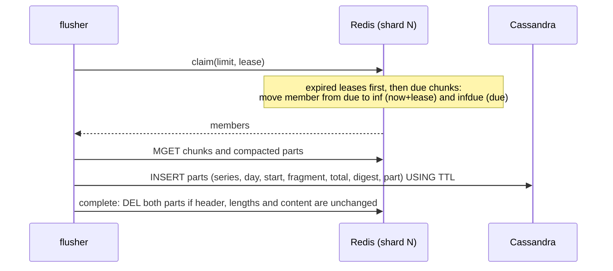

# xtsdb architecture

This document describes how xtsdb stores data and why the design is safe
against the failures that a two-tier time series database has to survive.

## Goals

1. Never lose an acknowledged sample when it moves between tiers.
2. Scale each tier and each role independently.
3. Be usable from the existing ecosystem (Prometheus, Graphite, Grafana)
   without custom clients.
4. Keep the tiers behind small interfaces (`internal/storage`) so that other
   key-value stores can be added. The persistent tier and the index run on
   Cassandra or TiKV; a conformance suite (`internal/storage/storagetest`)
   defines the semantics every backend must provide.

## Components

| Package | Responsibility |
|---------|----------------|
| `internal/model` | Label canonicalization, series IDs, sharding, chunk windows, day buckets. Part of the storage format. |
| `internal/chunk` | Raw sample records and compacted parts (hot tier), Gorilla/XOR blobs (cold tier), merging and de-duplication. |
| `internal/hot` | Hot tier on Redis/Valkey: Lua scripts for append, compaction, claim, complete. |
| `internal/storage` | Interfaces of the tiers; `storagetest` holds in-memory stores and the backend conformance tests. |
| `internal/cassandra` | Cold tier and series index on Cassandra; schema migration. |
| `internal/tikv` | Cold tier and series index on TiKV (RawKV). |
| `internal/ingest` | Writer (validation, index, append), Remote Write 1.0/2.0 handler, Graphite server. |
| `internal/flush` | Flusher: moves closed chunks from the hot to the cold tier, and compacts open chunks. |
| `internal/query` | Matcher resolution, tier merge, Prometheus HTTP API on the Prometheus PromQL engine. |
| `internal/app`, `cmd/xtsdb` | Wiring of roles, configuration, lifecycle. |

## Data model

**Series identity.** Labels are validated (UTF-8, length and count limits,
`__name__` required), empty values are dropped and the set is sorted. The
series ID is the xxhash64 of `name 0xff value 0xff ...` over the sorted
labels. Because the hash input is fixed, IDs do not depend on label order
or on the in-memory label representation; a golden test pins the function.

Two different label sets can hash to the same ID: over the series held
during the retention period, the probability is about n²/2⁶⁵ (2.7e-4 for
10⁸ series, 2.7% for 10⁹). Such collisions are detected when the series
is indexed (see [Series index](#series-index-cassandra)): the series that
recorded the ID first keeps it, and samples of the other one are rejected.

**Shards.** A series belongs to hot-tier shard
`(id >> 32) mod storage.shards`. All keys of a shard share the Redis hash
tag `{N}`, so they live in one Redis Cluster slot and Lua scripts over a
shard are atomic. With the default 256 shards the load spreads across up to
256 slots regardless of how series are labelled (0.x used the `hostname`
label as the hash tag, which put all untagged Graphite data in one slot).

**Chunk windows.** Samples of a series are grouped into windows of
`chunk_range`. Window boundaries are offset per series
(`id mod chunk_range`), so windows of different series close at different
times and flushing is spread out instead of happening in bursts.
A window is *due* at `start + chunk_range + grace_period`.

## Hot tier (Redis)

```
<prefix>:{N}:c:<series>:<window>           chunk: 16-byte header + 16-byte records
<prefix>:{N}:z:<series>:<window>           compacted part of the chunk
<prefix>:{N}:due                           ZSET  member -> due time (ms), not yet claimed
<prefix>:{N}:inf                           ZSET  member -> lease expiry (ms), claimed
<prefix>:{N}:infdue                        ZSET  member -> due time (ms), claimed
<prefix>:{N}:clock                         last fragment issued in the shard
<prefix>:{N}:w:<series>                    ZSET  window start -> window start, chunks of the series
<prefix>:{N}:compact                       compaction lease of the shard
<prefix>:{N}:q:<series>:<window>:<digest>  quarantined chunk (undecodable)
<prefix>:{N}:qz:<series>:<window>:<digest> its compacted part
<prefix>:{N}:qidx                          ZSET  quarantine key -> expiry time (ms)
<prefix>:meta                              HASH  layout parameters (shards, chunk range)
```

The chunk header is the chunk's *fragment*: 16 ASCII digits that identify
this incarnation of the window and order it after every earlier
incarnation. It comes from a hybrid clock per shard: the Redis server time
in microseconds, or one more than the last fragment issued in the shard
(`<prefix>:{N}:clock`) when the server clock is behind it. Fragments
therefore keep increasing when the Redis clock steps backwards (an NTP step,
or a failover to a node with a slower clock); after a restore from an
older snapshot, which rewinds the shard clock, the server time has normally
moved past the fragments issued before. Records are appended in arrival
order, so an append never reads the chunk:

- a float sample is 16 bytes: a big-endian timestamp (ms) and IEEE-754
  value;
- a native histogram is 16 bytes, its timestamp and `0x7ff4 << 48 | length`,
  followed by the histogram as a Remote Write 2.0 protobuf `Histogram`,
  padded to a multiple of 16 bytes. That value word is a NaN that float
  records never hold: incoming NaNs with the same top 16 bits are stored as
  the standard NaN, which PromQL does not tell apart (the stale marker is a
  different NaN and is kept). Chunks therefore stay a multiple of 16 bytes,
  and a series may change between floats and histograms.

A chunk may also have a compacted part (`z`), which
[compaction](#compaction) writes and nothing else changes: the 16-byte
header of the chunk it belongs to, the number of records folded into it
(uvarint), then float samples XOR-encoded as in the cold tier (the
[`chunk.Encoding`](#cold-tier-cassandra) byte 1 and the blob). The raw
records were appended after every sample of the compacted part, so reading
the chunk merges `compacted ++ raw` and the latest write still wins; its
records are those of both parts. A compacted part that does not decode
(another encoding, more samples than records, samples out of order, a
header that is not the chunk's) makes the chunk undecodable.

Integer histograms are stored as float histograms, which represent them
exactly; remote write validates them as integer histograms first. A
histogram may have at most 16,384 buckets, spans and custom bounds each, and
must have a finite, non-negative zero threshold (`outcome="invalid"`
otherwise); the buckets of a remote write request count towards
`ingester.max_samples_per_request` before it is decoded. A hot record that
does not decode into a valid histogram is treated as corruption and
quarantined. The raw part of a chunk is limited to 32 MiB (about two
million samples); samples beyond that are rejected (`outcome="chunk_full"`)
rather than creating a chunk that cannot be flushed. Compaction stops once
a chunk holds more records, in both parts, than a full raw part, so a chunk
holds at most about four million float samples.

xtsdb refuses to start if `storage.shards` or `storage.chunk_range` differ
from the values recorded in `<prefix>:meta`, because either change would make
existing chunks unreachable.

### Ingestion

Before anything is stored, the ingester:

- bounds remote write requests: compressed and decompressed size, strict
  Snappy (no S2 extensions), and the number of series, samples, labels and
  other elements, counted on the wire before protobuf decoding (decoding
  inflates empty elements up to 64 times); concurrent requests beyond
  `ingester.max_inflight_requests` get 503;
- drops samples older than `chunk_range + grace_period` (+1 minute of clock
  skew) or further than `max_sample_future` in the future, so that
  out-of-range timestamps never reach the index;
- writes the index, so that a stored sample always belongs to a
  discoverable series, and rejects the samples of a series whose ID is
  already used by a different label set (`outcome="collision"`).

Graphite TCP lines wait at most one second in a batch, whether or not more
data arrives. Connections are capped (`graphite_max_connections`), idle
connections are closed after five minutes, and accept errors such as
`EMFILE` are retried with back-off. UDP datagrams are copied off the socket
by one goroutine and parsed by a worker pool; when the workers fall behind,
datagrams are dropped and counted (`outcome="dropped"`).

### Append (ingester)

One Lua script call per shard and batch (`internal/hot/scripts.go`):

1. Read the server time with `TIME` and compute the fragment for chunks
   created by this call.
2. For every chunk in the batch: if the window is due, or the chunk is
   currently claimed by a flusher, reject its samples (`too_old`); if the
   chunk would exceed its size limit, reject them (`chunk_full`).
3. Otherwise create the chunk with its header if needed, register it in
   `due` with its due time, and `APPEND` the records.

Scripts are run with `EVALSHA` in pipelines and transparently fall back to
`EVAL` when a node lost its script cache (restart, failover, `SCRIPT
FLUSH`, new cluster node). The append script has no flags, so Redis refuses
it as a whole when it is out of memory (the client gets 503 and retries).

### Compaction

Raw records take 16 bytes per sample, and Redis grows a string greedily on
`APPEND` (to twice its new length below 1 MiB), so a chunk built by appends
held 28 bytes per sample on average. Gorilla compression at append time
would need the state of the previous sample in a stateless ingester that
does not read the chunk; the evaluation in
[hot-compression.md](hot-compression.md) chose to compress the float
samples of open chunks in the background instead. With compaction every
10 minutes, Redis holds about 9 bytes per sample instead of 29, for 22% more
CPU time of the Redis main thread (generated data at a 15 s interval,
Redis 7.0).

Every `flusher.compaction_interval` (10 minutes by default, 0 disables it),
the flushers compact each shard:

1. A flusher takes the compaction lease of the shard,
   `SET <prefix>:{N}:compact NX PX <interval>`, in a script flagged
   `allow-oom`; if another flusher compacted the shard less than an interval
   ago, it moves on. Flushers offer every shard ten times per interval, in
   random order, so a shard is compacted about once per interval whatever
   the number of flushers.
2. It lists the open chunks of the shard from the due set, in pages that
   follow the due times, leaving out those that close within a minute (the
   flusher compresses them soon anyway), and keeps those with at least
   12 raw records (`STRLEN` of 16 + 192 bytes or more). With fewer, creating
   the compacted part can take more memory than the records it replaces,
   and the cost of a compaction would be spread over few samples.
3. It reads each chunk and its compacted part with one `MGET`, merges them
   (`Normalize(compacted ++ raw)`) and encodes the result, with the record
   count of both parts, as the new compacted part. Encoding runs in the
   flusher, with the XOR encoder of the cold tier. A chunk is left as it is
   (`outcome="kept"`) if it holds native histograms, more records than a
   full raw part, or if the new compacted part would not be smaller than
   the raw records and compacted part it replaces.
4. The compaction script swaps the parts, for up to 256 chunks per call.
   For each chunk it checks that:
   - the window is still open by the clock of the Redis node (the due time
     in the due set is later than now), as `append` does;
   - the chunk still starts with exactly the bytes that were read;
   - the compacted part is still the one that was read.

   Then it sets the compacted part and rewrites the chunk as its header
   followed by the records appended since it was read. A chunk that fails a
   check is left for the next compaction.
5. A pass stops once it has run for an interval, so that passes over a
   large shard do not pile up; the next pass goes on.

Properties:

- **The append path is unchanged.** Ingesters still append without reading;
  compaction keeps every record appended after its read.
- **A due window is immutable.** Compaction, like append, acts only before
  the due time by the node's clock, so once `claim` can see a chunk nothing
  changes it, and the fences of `complete` and `quarantine` stay valid.
- **Samples never change.** The compacted part holds exactly the float
  samples the records it replaced resolved to, bit for bit, and their
  count. Reads, flushes, the `total` and the digest of a version are the
  same with or without compaction. Native histograms are not compacted:
  decoding them from a Prometheus chunk would change their counter reset
  hints, and with them what PromQL sees.
- **Fenced by content.** Comparing lengths would not do: after a failover to
  a lagging replica, other records of the same length may have been
  appended, and a retried remote write can append the same bytes again after
  another compaction. The compacted part changes with every compaction (its
  record count grows), and the raw part is compared byte for byte.
- **Works when Redis is full.** The lease and compaction scripts are flagged
  `allow-oom`: with 12 records or more, every compaction frees memory, also
  the first one, which creates the compacted part (measured in
  [hot-compression.md](hot-compression.md#memory-effect-of-one-compaction)).
- **Atomic for readers.** Reads load both parts with one `MGET`, so they
  never see a compaction half done.

The cost is CPU time of the Redis main thread for listing, reading and
swapping, and for appending again to a raw part that compaction shortened:
22% more than without compaction every 10 minutes, 29% every 5 minutes, at
a 15 s interval. Compaction trades CPU for memory: it lets a Redis main
thread hold more series when memory limits it (below about 14 GB per thread
at these rates), and fewer when CPU does; see
[hot-compression.md](hot-compression.md#comparison-under-the-same-conditions).
`xtsdb_flusher_compaction_chunks_total{outcome}` counts the chunks processed
(`compacted`, `kept`, `changed`, `failed`);
`xtsdb_flusher_compaction_input_bytes_total` and
`xtsdb_flusher_compaction_output_bytes_total` count the bytes compaction
read and replaced (raw records and the earlier compacted part, which is
counted again at every compaction) and the compacted parts it wrote. The
memory saved shows in `used_memory` of Redis.

### Hand-off protocol (flusher)



Invariants:

- **A due window is immutable.** Append, compaction and claim compare
  against the same Redis node clock inside atomic scripts, so once `claim`
  can see a chunk, no append or compaction can change it. 0.x had a window between `GET` and `UNLINK`
  in which appended samples were deleted.
- **Delete after persist.** A chunk is deleted only after all its parts were
  written to Cassandra.
- **Leases, not ownership.** A claimed chunk whose flusher dies or is too
  slow is handed out again when its lease expires.
- **Idempotent by content.** The Cassandra key includes the chunk's sample
  count and a hash of its samples. Writing the same chunk twice stores it
  once; writing a different version of the same window (for example after
  Redis was restored from an older snapshot) stores a second version
  instead of overwriting a more complete one. Reads merge all versions.
- **Fenced completion.** `complete` deletes a chunk and its compacted part
  only if its header and the length and content of both parts are still
  those that were persisted. A flusher whose lease expired cannot delete a
  newer incarnation, and samples appended after the chunk was loaded
  (possible only after a failover to a lagging replica) are not deleted: the
  chunk is re-processed after its lease. Lengths are compared first, and the
  content (`redis.sha1hex` of each part, the only digest a script computes)
  only when they match. Lengths alone would not do: after such a failover the
  chunk can hold the same number of other records, or a compacted part
  exactly as long, and since the shard clock key goes back with the replica,
  a later incarnation can even reuse the fragment that was persisted
  ([spec/](../spec/README.md) finds both). Reading the content into the
  script costs the Redis main thread a few milliseconds per MiB (about 3 ms
  on the Redis 7.0 we measured), so one call reads at most 8 MiB, as one
  compaction call writes; a chunk of the default hour at a 15 s interval
  holds a few KiB.
- **No leaks.** In-flight entries whose chunk no longer exists are released,
  and a compacted part left behind is deleted.
- **Fenced quarantine.** A chunk that cannot be decoded is moved to a
  quarantine key so that it does not block flushing, but only if its first
  16 bytes and the length and content of both parts are still those that
  were read, exactly like `complete`. A healthy newer incarnation of the window is never moved
  away. See [Quarantined chunks](#quarantined-chunks).
- **Flushing works when Redis is full.** claim, complete, quarantine and
  compaction are flagged `allow-oom`; with `noeviction`, flushing and
  compaction are the only ways memory is freed, so they must not be refused.
- **Progress under slow storage.** A batch stops starting new writes once
  its lease has expired, completes what it persisted with its own timeout,
  and a flusher moves on when a batch made no progress.

[`spec/XtsdbHandoff.tla`](../spec/README.md) models append, compaction,
claim, complete and the read order in TLA+, including failovers to a lagging
replica; `make test-tla` checks these invariants with TLC.

No Redis keyspace notifications are used. 0.x relied on them; they are
node-local, delivered at most once and require special server
configuration, and a mismatch between notification payloads and key names
left data in Redis forever.

### Failure handling

| Failure | Outcome |
|---------|---------|
| Flusher crashes after claim | Lease expires, another flusher claims and persists the chunk. |
| Cassandra unavailable or slow | Persist fails or is skipped, the chunk stays in Redis and is retried after the lease. `xtsdb_flusher_lag_seconds` grows (it covers claimed chunks too), and queries still read the chunk from Redis. |
| Two flushers persist the same chunk | Same primary key, written once. The second `complete` is a no-op. |
| Redis out of memory (`noeviction`) | Appends are refused (503, clients retry); claim and complete keep working, so flushing frees memory. |
| Redis restart / `SCRIPT FLUSH` | Scripts are reloaded automatically. Unflushed data loss is bounded by the Redis persistence settings. |
| Redis restored from an older snapshot, or failover to a lagging replica | Chunks flushed since the snapshot may be flushed again with less data; they are stored as separate versions and never overwrite the complete one. |
| Undecodable chunk in Redis | Moved to a quarantine key (fenced, see below), logged and counted; it does not block flushing. Compaction leaves it alone (`outcome="failed"`). |
| Undecodable part in the persistent tier | Skipped by reads and logged with its key; queries return the other samples, and an older version's value where the part held the newest one. See [Corrupt data in the persistent tier](#corrupt-data-in-the-persistent-tier). |
| Chunk changes during a compaction (an append, another compaction, its window closes, a new incarnation) | Appended records are kept; in the other cases the compaction of that chunk does nothing (`outcome="changed"`) and is retried at the next interval if the window is still open. |
| Flusher dies during a compaction | The swap is one atomic script: either both parts changed or neither. The shard waits for its lease to expire, at most one interval. |
| Compaction is disabled or slow | Raw records stay as they are; nothing but memory use depends on it. |
| Redis clock steps back | The compaction lease of a shard (a `PX` expiry) lasts longer by the size of the step, and the shard is not compacted meanwhile. |
| Keys evicted (a `maxmemory-policy` other than `noeviction`) | A chunk evicted without its compacted part leaves it next to the next incarnation of the window, which is then undecodable and quarantined when flushed; a compacted part evicted alone loses the samples it held. Use `noeviction`. |
| Very large chunk | Persisted in parts of at most 100,000 samples and 4 MiB, below Cassandra's mutation limit (TiKV stores parts in segments of 8 KiB). A single native histogram is limited to 16,384 buckets (about 130 KB), so every part fits. |
| Sample for a closed window | Rejected and counted (`outcome="too_old"`); remote write returns 400. |
| Redis clock moves backwards | A claimed chunk still rejects appends (the in-flight check). A chunk re-created after completion gets a larger fragment from the shard clock and is stored as a separate version that takes precedence; reads merge versions. |
| Index write fails | The batch fails with 503 before any sample is stored; the client retries. |

### Quarantined chunks

A chunk that cannot be decoded (its length is not a whole number of
records, its header is not a timestamp, or its compacted part does not
decode or belongs to another incarnation) can only be the result of a bug,
of eviction or of tampering with Redis, but it must neither block flushing
nor be lost silently:

- It is renamed to `<prefix>:{N}:q:<series>:<window>:<digest>`, where
  `digest` is the xxhash64 of the length of its content, its content and
  its compacted part.
  Different chunks of the same window therefore never overwrite each other
  in quarantine. Its compacted part, if any, is renamed to the same key with
  `qz` for `q`, and expires with it.
- The rename is fenced on the first 16 bytes and on the length and content
  of both parts that were read.
  If the chunk changed since (a newer incarnation after a failover or a
  clock step), it stays in flight and is read again after its lease.
- The quarantine key is recorded in `<prefix>:{N}:qidx` and expires after
  `flusher.quarantine_ttl` (30 days by default; 0 keeps it until it is
  deleted).
- `xtsdb_flusher_chunks_total{outcome="quarantined"}` counts quarantines and
  `xtsdb_hot_quarantined_chunks` reports how many are held. Queries do not
  read quarantined chunks.

`xtsdb quarantine list` shows every quarantined chunk with its series ID,
window, size (of both parts), header and expiry; `redis-cli GET <key>`
returns the raw content (16-byte header followed by 16-byte big-endian
records of timestamp and IEEE-754 value), and `GET` of the `qz` key the
compacted part. `xtsdb quarantine delete <key>...` or
`xtsdb quarantine delete -all` deletes them with their compacted parts.

## Cold tier (Cassandra)

```sql
CREATE TABLE chunks (
  series_id bigint, day int, start_ms bigint,
  fragment bigint, total int, digest bigint, part int,
  max_t bigint, samples int, encoding tinyint, data blob,
  PRIMARY KEY ((series_id, day), start_ms, fragment, total, digest, part)
) WITH compaction = {'class': 'TimeWindowCompactionStrategy', ...};
```

`day` is the UTC day of the window start, which bounds partition size.
`(fragment, total, digest)` identify a version of a window, `part` splits
large versions into rows of at most 100,000 samples and 4 MiB. The blob of a
window with float samples only (`encoding` 1) is a sequence of
length-prefixed Prometheus XOR chunks of sorted, de-duplicated samples
(Gorilla encoding; typically 1–2 bytes per sample compared to 16 for a raw
record in Redis).
A window with native histograms (`encoding` 2) is a sequence of segments,
each a Prometheus chunk encoding byte (XOR or float histogram), the chunk's
length and the chunk, in time order; a new histogram chunk starts at a
counter reset or an incompatible bucket layout, as in the Prometheus TSDB,
and also when the bucket layout of the chunk (the union of the layouts of its
histograms) would become one that reads refuse, for example one of more than
16,384 spans (see [Corrupt data in the persistent
tier](#corrupt-data-in-the-persistent-tier)). A chunk holds at most 16,384
samples.
A row expires `storage.retention` after its last sample (`USING TTL`), and
TWCS drops whole SSTables when they expire. Index entries of a day expire two
days after the samples of that day; series rows two days after they were
last written. Data that is already older than the retention is not written,
which matters for imports.

`total` is the number of samples appended to the incarnation in Redis,
including samples that were overwritten by a later sample with the same
timestamp: an incarnation only grows, so a larger `total` is a later state
of it.

Reads for `[mint, maxt]` query the day partitions of
`[mint - chunk_range, maxt]` with a clustering range on `start_ms`,
concatenate the parts of each version and merge versions in clustering
order. Where versions disagree on the value at a timestamp, the version
that sorts last wins:

1. the larger `fragment`: a later incarnation of the window;
2. then the larger `total`: a later state of the same incarnation, for
   example the complete chunk rather than what an older snapshot held;
3. then the larger `digest` as a signed 64-bit value. Versions with equal
   `fragment` and `total` but different content can only come from diverging
   histories of one incarnation (a restore or a failover to a lagging
   replica, followed by different writes to the same window). Which one is
   newer cannot be known; the digest makes the choice deterministic and the
   same for every reader, but arbitrary.

All of this matters only when a client writes different values for the same
timestamp of a series and, around the same time, Redis fails over, is
restored or its clock steps.

## Imports

`xtsdb import` reads Prometheus TSDB blocks (with the index, chunks and
tombstones readers of the Prometheus TSDB; deleted samples are left out) or
OpenMetrics text, and writes every series the way the ingester and the
flusher together would: index entries first, for every day the series has
samples on (with the same collision detection), then one version per chunk
window, cut on the same window boundaries.

Imported versions have fragment 0. Every fragment issued by the hot tier is
a timestamp in microseconds, so imported versions sort before ingested ones
and lose wherever both have a sample at the same timestamp: an import fills
gaps but never overrides data xtsdb received itself. The fragment being
constant also makes imports idempotent: importing the same samples again
writes the same primary keys. A window cut in several parts (two blocks
that both cover it, or OpenMetrics input imported in slices to bound memory)
is stored as several versions, which reads merge.

## Series index (Cassandra)

```sql
series       (series_id) -> labels map
postings     ((day, name, value, bucket), series_id)   bucket = series_id mod B
label_values ((day, name, bucket), value)              bucket = xxhash64(value) mod B
label_names  (day, name)
meta         (name) -> value                           index_buckets = B
```

The ingester writes the entries of a series once per UTC day it has samples
on, guarded by an LRU cache and de-duplicated within a batch. Index rows
live two days longer than samples. Day partitions keep postings bounded and
make lookups time aware: a series that disappeared last month is not a
candidate for today's queries.

**Buckets.** A label pair shared by many series, such as the metric name of
a large metric, would otherwise put all of them in one partition per day
(a million series make a partition of a million rows), which Cassandra warns
about and which slows down compaction, repair and every query using that
matcher. Postings and label values are therefore spread over
B = `storage.index_buckets` partitions (16 by default): a write goes to one
bucket, and a lookup reads all B buckets in parallel and concatenates them
(buckets are disjoint). B is recorded in the `meta` table on first start and
xtsdb refuses to start with a different value, because entries would then be
looked up in the wrong buckets. With B = 1 every lookup reads one partition,
as before; larger values bound partitions further at the cost of more,
smaller reads per lookup. A stress test (`XTSDB_TEST_STRESS=1`) indexes a
million series sharing one pair: the largest partition holds about 63,000
rows and reading all postings back takes about 1.5 s on one local node.

Keyspaces created by builds without buckets cannot be migrated in place
(the partition key of `postings` and `label_values` changed): `xtsdb
migrate` refuses them and explains how to proceed.

**Collision detection.** The `series` row is written with one lightweight
transaction per series and day:

```sql
UPDATE series USING TTL ? SET labels = ? WHERE series_id = ?
  IF labels IN (?, null)
```

It creates the row, or refreshes its TTL when it already holds the same
labels. When the ID belongs to different labels, nothing is written: the
ingester rejects the samples of the new series (`outcome="collision"`,
remote write answers 400), counts the series in
`xtsdb_ingester_series_collisions_total`, logs both label sets and does not
write its postings or label values. Later samples of that series are
rejected from a small cache without asking Cassandra again. The ingester's
cache of indexed series is keyed by the ID and a second, independent hash
of the labels, so a colliding series is never taken for the cached one.
Transactions use `LOCAL_SERIAL` when `cassandra.consistency` is a `LOCAL_`
level and `SERIAL` otherwise.

The transaction costs a few more round trips than a plain write, once per
series and day. 128-bit series IDs would make collisions practically
impossible, but would change the storage format.

## Cold tier and index on TiKV

With `storage.backend: tikv`, chunks and the index are stored through the
RawKV API of TiKV, which keeps keys sorted and splits them into regions by
itself. Every key starts with `storage.key_prefix` and `:`, then a tag:

```text
m <name>                                                    -> value       layout (meta)
c <series> <start> <fragment> <total> <digest> <part> <seg> -> segment     chunks
s <series>                                                  -> expiry, labels  series
p <hash(name, value)> <day> <name> <value> <series>         -> 0x01        postings
v <hash(name)> <day> <name> <value>                         -> 0x01        label values
n <day> <name>                                              -> 0x01        label names
```

Integers are fixed-width big-endian, signed ones with the sign bit flipped,
so keys sort like the numbers. Strings are prefixed with their length, so a
key is unambiguous whatever bytes a label holds (NUL included) and a lookup
is an exact prefix scan. The longest key, with labels of the maximum length
(2048 bytes), stays below TiKV's 8 KiB key limit. The 16-bit hash in front
of the day of postings and label values places the entries of a new day
next to those of the same label on earlier days, all over the key space: at
midnight UTC every active series writes postings for the new day, which
would otherwise all go to one new range, and so to one region.

**Chunks.** The chunks of a series are one contiguous range ordered by window
start and then by version in the order of precedence (`fragment`, `total`,
`digest` as a signed value), the same order as the clustering order in
Cassandra. A read for `[mint, maxt]` is one range scan per series over the
window starts in `[mint - chunk_range, maxt]`; no day partitioning is
needed. A part is split into segments of at most 8 KiB; most parts fit in
one. Each segment value holds the encoding, the number of segments of the
part, `max_t`, the sample count and a checksum of the whole blob of the
part, then its slice of the blob. A part is used only if all its segments
are present, agree on the header and match the checksum: a part that is
being written, or whose write failed half way and was not retried yet, is
skipped (logged at debug level; the hot tier still holds its samples), and
segments of different writes are never mixed (logged as a warning). Segments beyond the count of
segment 0 are left over from an earlier write of the part in more segments
(by a build that encoded it differently) and are ignored until they expire.
Small values keep every request within TiKV's response limit
(`server.max-grpc-send-msg-len`, 10 MiB by default): reads take as many
entries at a time as fit in 8 MiB if every one were as large as allowed
(about 1000 segments; 2048 or more index entries; about 30 label sets for
`SeriesLabels`, whose entries can be 260 KB in the worst case). Within a
build, writes are idempotent: the same part always produces the same keys
and values.

**Retention.** Entries carry RawKV TTLs with the rules of the Cassandra
backend: chunks expire `storage.retention` after their last sample, index
entries of a day two days after the samples of that day, series entries two
days after their last write, and entries that are already expired are not
written. TiKV must run with `storage.api-version = 1` and
`storage.enable-ttl = true` (`tikv.api_version: v1ttl`, the default), where a
compaction filter drops expired entries, or with `api-version = 2`. API v2
keeps versions of every entry and drops expired ones only below the GC safe
point, which TiDB in the same cluster or a RawKV GC worker advances; on a
cluster with neither, expired data is never removed from disk.

**Collision detection.** A series entry holds the labels and the time until
which it owns its ID (retention plus two days after it was written). It is
claimed with `CompareAndSwap(key, absent -> entry)`. If an entry already
exists, it decides: the same labels are recorded again; other labels that
still own the ID are a collision, handled as with Cassandra; an entry whose
time has passed is taken over with a compare-and-swap on its exact value.
An entry of the same labels that expires within an hour is also refreshed
with a compare-and-swap, so that it cannot expire and be claimed by other
labels in between. Compare-and-swap cannot set a TTL, so the entry is then
written again with one. Reads and claims go by the time in the entry, not
by the TTL: an entry whose TTL write failed (a timeout or a crash between
the two writes) still expires, and the TTL only frees the space.
Compare-and-swap needs the atomic mode of RawKV, so xtsdb uses it for every
write: TiKV is linearizable for a key only if all its writers agree on the
mode.

**Layout.** `format` and `chunk_range_ms` are recorded under meta keys with
compare-and-swap on first start, and xtsdb refuses to start with a different
`storage.chunk_range`. With a retention, xtsdb also writes an entry with a
TTL at startup, so that a cluster without TTLs is reported then rather than
by every write. The Redis meta records `storage.backend` once the
persistent tier has been reached, so that a deployment does not switch
backends and split its series between two stores; a start that fails to
reach its backend records nothing. `storage.index_buckets` does not apply: a label pair
shared by a million series is a range of a million keys, which TiKV spreads
over regions; a lookup reads it in pages of up to 10,240 keys.

## Read path

1. **Bound the range.** Queries are clamped to `storage.retention` (or
   `querier.max_query_lookback` when retention is 0, default one year), which
   bounds the number of day partitions read. At most
   `querier.max_concurrent_queries` queries run at once, each bounded by
   `querier.timeout`, including the series and label endpoints.
2. **Resolve matchers** for each day of the range. Matchers that do not
   match the empty string select postings: `=` reads one pair (its B
   buckets), `=~` with a literal alternation reads one pair per alternative,
   other matchers filter `label_values` first. Cheap matchers run first; once 1,024 or fewer
   candidates remain, expensive matchers are not resolved through the index
   but applied to the labels. Postings are intersected across matchers and
   unioned across days. Selectors without such a matcher are rejected, as in
   Prometheus.
3. **Load labels** of the candidates (LRU cached) and apply all matchers,
   including negative ones, on the full label sets.
4. **Evaluate PromQL** with the Prometheus 3 engine through the
   `storage.Queryable` interface. Samples are loaded lazily, 256 series at a
   time, when the engine iterates a series, so `querier.max_samples` stops a
   query before all of its raw samples are in memory.
5. **Read samples** of a batch from Redis first and Cassandra second, and
   merge them; hot samples win on equal timestamps.

The order of step 5 is what makes the hand-off invisible to queries. A
flusher writes a chunk to Cassandra before deleting it from Redis, so a
chunk missing from the Redis read was already in Cassandra when the
Cassandra read started. Reading both tiers concurrently (as an earlier
version of v2 did) loses chunks that are persisted after the Cassandra read
and deleted before the Redis read. With Cassandra replication, the read and
write consistency levels must overlap (`LOCAL_QUORUM`, the default) for the
same argument to hold. TiKV needs no setting: RawKV reads are served by the
leader of a region and see every write that was acknowledged before.

Redis is read for at least `querier.hot_lookback` and, using the oldest due
time in the `due` and `infdue` sets (refreshed every 10 seconds), back to the
oldest chunk Redis still holds, so data stays visible while flushing lags.

**Window index.** Every series has a sorted set of the windows it holds in
Redis (`<prefix>:{N}:w:<series>`). The append script adds a window when it
creates its chunk; `complete` and `quarantine` remove it in the same atomic
step that deletes or renames the chunk. A read first fetches the windows of
every series in the range (`ZRANGEBYSCORE`, one command per series) and then
only the chunks that exist (one `MGET` of both parts per chunk), in
pipelines. The cost of
a read is therefore one command per series plus one per chunk, independent
of the length of the range and of `chunk_range`; enumerating every possible
window instead would cost `(range / chunk_range) + 1` commands per series,
for example 361 with a 6 hour range and a one minute `chunk_range`, and more
while flushing lags. Chunks written by builds that predate the window index
are registered once, from the `due` and `inf` sets, when xtsdb starts and
`<prefix>:meta` has no `window_index` field; a chunk is registered only if
it still exists, atomically, so a chunk completed meanwhile leaves no entry.
Chunks that such builds create while they still run (during a rolling
upgrade) are not indexed, so queries miss their samples until they are
flushed to Cassandra: at most `chunk_range` + `grace_period` after the last
older ingester stopped. Older flushers do not remove window index entries,
and older builds cannot read native histogram records. When upgrading from
an earlier v2 build, stop all its processes (ingesters and flushers) before
starting the new ones.

### Corrupt data in the persistent tier

Parts are decoded with the chunk iterators of the Prometheus TSDB, which
trust their input: a corrupt float histogram chunk can claim billions of
buckets, which they allocate before reading any, and other corrupt chunks
make them panic. Running out of memory kills the process, and Go cannot
recover from it. Every chunk is therefore checked first against what xtsdb
writes:

- a part holds at most 100,000 samples, and a chunk at most 16,384;
- the bucket layout of a histogram chunk, which all its histograms share,
  must pass native histogram validation (a valid schema, a finite,
  non-negative zero threshold, at most 16,384 spans and custom bounds, and
  so on), except for the limit on buckets: the layout of a chunk is the
  union of the layouts of its histograms, and earlier builds wrote chunks
  with more buckets than one histogram may have;
- the chunk must be long enough for the buckets its layout claims, which the
  first histogram of a chunk stores as raw 64-bit floats.

Histograms decoded from one chunk also share a single copy of its spans and
custom bounds, which would otherwise be copied for each of them; the querier
copies the histograms it hands to the PromQL engine, which overwrites them.
Decoding corrupt data then takes about as much memory as decoding valid data
of the same size, and a panic while decoding is reported as corruption.

A part that fails to decode is skipped, deliberately. Unlike the hot tier,
the persistent tier has no quarantine, and a part normally stays as written
until it expires, so a read that failed on it would fail every query of that
series over that window until then. The read still returns the samples of
the other parts and versions of the window, and of Redis. Where the skipped
part held the newest value at a timestamp, the value of an older version of
the window is returned instead, for example an imported one: versions only
disagree after a client wrote different values for the same timestamp, as
described for the cold tier above. The query neither fails nor carries a
warning, and there is no metric: the part shows up only in the logs, once
for every read that covers it. It is logged at error level as `skipping
undecodable chunk` with its key: the series (16 hex digits), the window
start, fragment, total, digest and part, and with Cassandra the day. The
other values are logged as stored, but the `series_id` column of Cassandra
holds the series ID as a signed 64-bit integer. TiKV parts carry a checksum
that is checked first, so bytes that changed after the write are logged as
`skipping chunk with segments of different writes` (a warning, as for two
writes mixed) or `skipping chunk with a malformed segment`, with the same
key.

Cassandra checksums what it stores and TiKV parts carry a checksum, so a
part that does not decode more likely comes from a bug, or from a build that
writes what this one refuses, than from bit rot: keep it until the cause is
known. With Cassandra, `DELETE
FROM chunks WHERE series_id = ? AND day = ? AND start_ms = ? AND fragment = ?
AND total = ? AND digest = ? AND part = ?` removes it; xtsdb has no command
to remove a part from TiKV.

## Changes from 0.x

| 0.x | v2 |
|-----|-----|
| Keyspace notifications + Redis Streams to detect expiry; payloads without the `ts:` prefix meant series that stopped receiving writes were never flushed | Due/in-flight sorted sets polled by flushers; no notifications |
| `GET` then `UNLINK` race lost concurrent appends | Due windows are immutable; completion fenced by header, lengths and content |
| Failed batches stuck in the stream's pending list forever | Leases with automatic re-claim |
| Graphite millisecond timestamps written as seconds (year 58815) | One timestamp unit (ms) end to end, tested |
| `EVALSHA` without fallback: writes failed after Redis restart | `EVALSHA` with automatic `EVAL` fallback |
| Series ID depended on tag order; `hostname` tag as hash tag | Canonical sorted labels; hash-based shards |
| No index, no query support (querier crashed on start) | Day-partitioned index, PromQL, Prometheus HTTP API |
| Raw 16-byte samples in Cassandra, unbounded partitions, consistency `ANY` | XOR compression, day partitions, TTL, TWCS, configurable consistency |
| Go 1.14, go-redis v7, gocql 2020, VictoriaMetrics 1.35 | Go 1.27, go-redis v9, Apache Cassandra GoCQL driver v2, Prometheus 3.15 |
